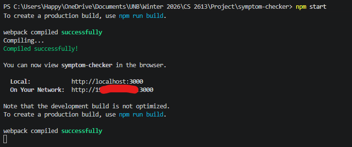
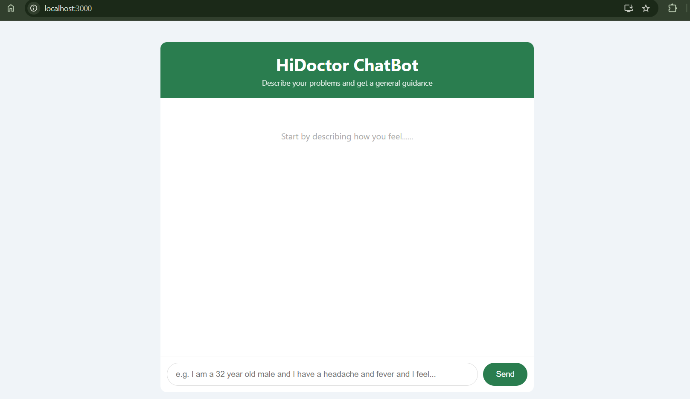
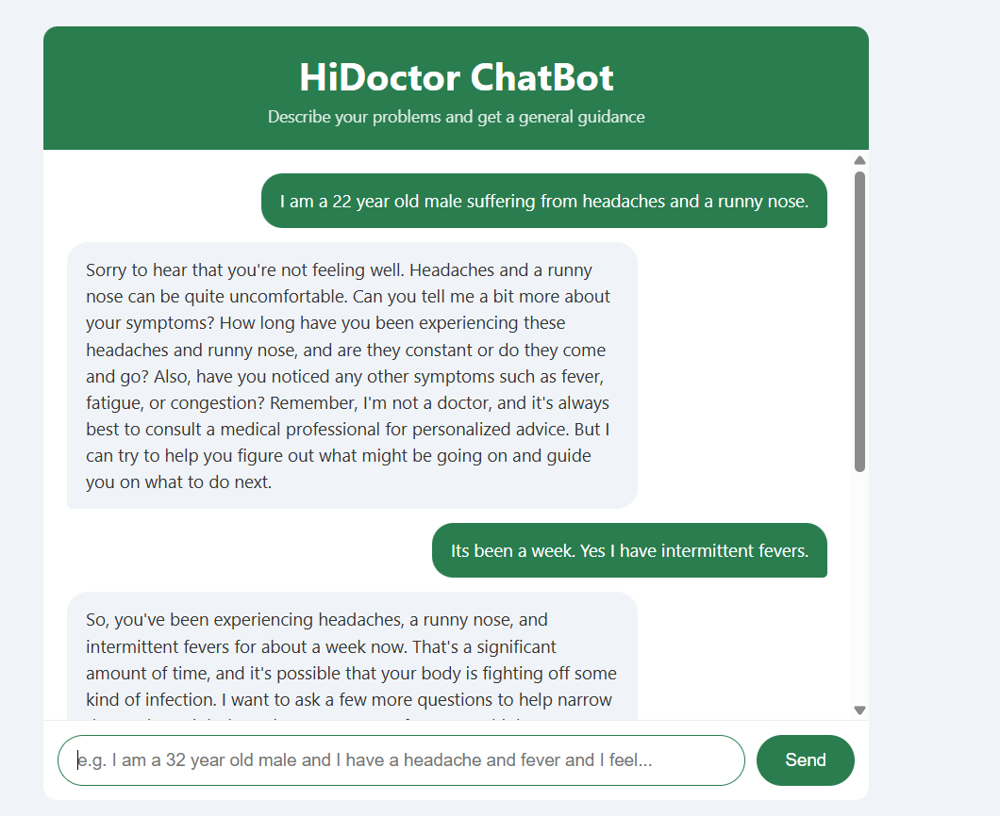
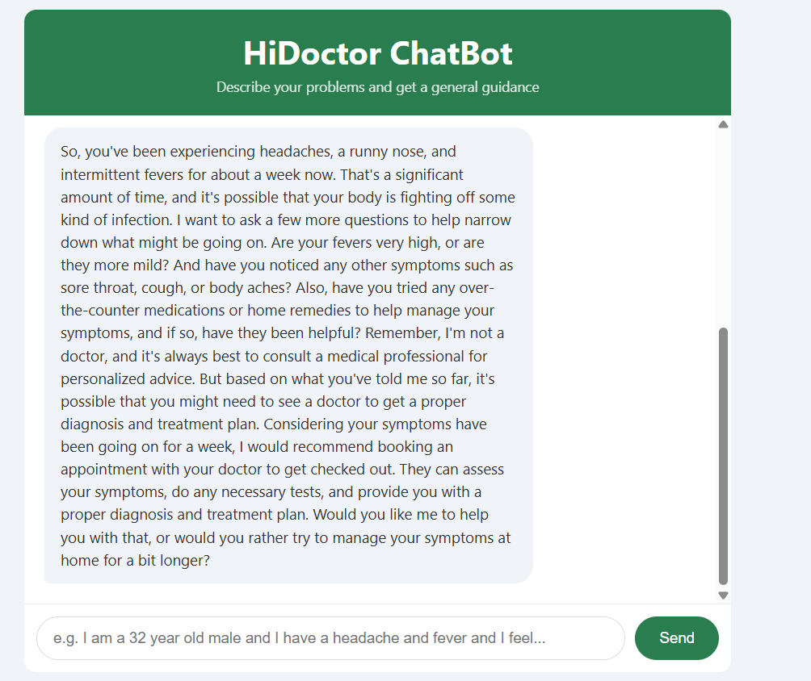

# HiDoctor Chatbot

HiDoctor is a simple AI chat application that allows an individual to describe the ailment and receive general medical guidance. Its built with **React** on the frontend and **Node.js/Express** on the backend, powered by the **Groq AI API**.

---

## 1. Which package/library does the sample program demonstrate?

This program demonstrates **React** an open-source JavaScript library used for creating user interfaces. React is used for the entire front-end including the chat interface, message history, loadding states and dynamic UI updates. 

## 2. How does someone run your program?

### Pre-requisites
- Have [Node.js](https://nodejs.org/en) installed.
- Set up a free account on [GROQ](https://console.groq.com/home) and get one of its generous free API key

### Step 1: Setting up backend

Open a terminal and navigate to the backend folder:
 
```bash
cd backend
npm install 
```
 npm install to install all the necessary modules. if already present might be good idea to reinstall. 
Open .env file and replace the `apiKey` value with your Groq API key. It should be like  this "GROQ_API_KEY = <yourapikeyhere>"

Then in the terminal run server.js which does all the backend work for us. 

```bash
node server.js
```

If done correctly you should see


### Step 2 — Start the frontend
 
Open a **second terminal** and navigate to the React app:
 
```bash
cd symptom-checker
npm install
npm start
```
 
Your browser will automatically open at `http://localhost:3000`.


 **BOTH TERMINALS FOR BACKEND AND FRONTEND SHOULD BE RUNNING AT THE SAME TIME**

 ## 3. What purpose does your program serve?
HiDoctor simulates a simple chatbot pop-up for a hospital front-desk helping patient get some quick information. The chatbot would ask further questions to figure ailments helping patients describe the ailments more accurately to the doctor. This can help free up clinic staff for more important work. This is a growing problem in many countries including Canada where hospital wait times are becoming outrageous. Conversational AIs can help mitigate this problem. 

The AI is given a prompt for its personality to be "empathetic, clear, and concise". To avoid legal issues the Ai is also instructed to "Always remind users you are not a doctor and they should seek professional medical advice".

## 4. What would be some sample input/output?





