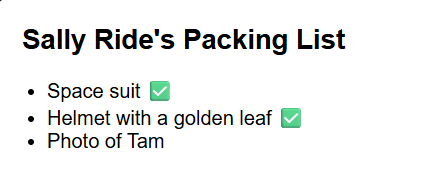

#Library Overview - React

---

## 1. Which package/library did you select?

**React** a JavaScript library from [react.dev](https://react.dev/).

---

## 2. What is the package/library?

### What purpose does it serve?

React is an open-source JavaScript library used for creating user interfaces [1]. Its introduced component based architecture where a complex webpage is broken down into small, reusuable, modular pieces called components. This bring all the advantages associated with modularity include making the code more organized and maintainable. Furthermore react improves performance by efficiently updating only the parts that changed in the application state.

Hence react is mainly used in front-end for building webpages and application interfaces. When it comes to webpages like in my project react is often paired with a backend such as Node.js which would handle all backend logic like data and API. 

### How do you use it?

Since I already had npm installed from the time I installed Node.js for class work I relied on it to install react as well. This made it super easy and convenient to set up react in a few simple steps. 
```bash
npx create-react-app nameofapphere
cd nameofapphere
npm start
```
This creates all the file structure and the files necessary for a simple project so that you can start writing components immidately. [2]

The core feature of react, component is created same as a javascript function with its curly brackets. Components can be nested within other components and used similar to HTML tags. Component names conventionally start with capital letters. [3]
```jsx
function MyButton() {
  return (
    <button>I'm a button</button>
  );
}

export default function MyApp() {
  return (
    <div>
      <h1>Welcome to my app</h1>
      <MyButton />
    </div>
  );
}
```

To make the UI dynamic we use state and hook. State is a component specific memory [5]. You add a state variable to a component using the useState hook [4]. React automatically handles all the stuff to re-render the component to reflect new data when the state changes. [4].
For example in my code I used the useState as follows. 
```jsx
import { useState } from 'react'; // must be on top
const [messages, setMessages] = useState([]); // chat history
const [input, setInput] = useState(''); // what user is tyoping
const [loading, setLoading] = useState(false); //for loading message
```
when you call useState it returns a variable and a function that acts as a setter for that variable. hence the convention [variable, setVariable]. Now using the first example with MyButton you can use useState to set up two counters that update indepdently[3].
```jsx
import { useState } from 'react';

export default function MyApp() {
  return (
    <div>
      <h1>Counters that update separately</h1>
      <MyButton />
      <MyButton />
    </div>
  );
}

function MyButton() {
  const [count, setCount] = useState(0);

  function handleClick() {
    setCount(count + 1);
  }

  return (
    <button onClick={handleClick}>
      Clicked {count} times
    </button>
  );
}

```

---

## 3. What are the functionalities of the package/library?

Some of the functionalities I used from the library are listed below. Some of them are already pretty common in node.js like fetch.

- Components - Reusuable pieces of code written as JavaScript functions. Explained in section 2.
- JSX - JSX is a syntax extension for JavaScript that lets us write HTML - like markup language in JavaScript. There are otherways to write components but JSX is the most commonly used [6].
- hooks like useState - Hooks are used to manage state. When a state change react re-renders. Explained in section 2.
- Event Handling - React has built in events for event-handling like onClick as used in the button example in section 2.
- Conditional Rendering - When you need to display different things depending on different conditions you use condtional rendering which uses the same JavaScript syntax for condtionals such as (if, &&, and ? : operators) [7]. 
For example you want to add a tick mark next to items in a PackingList if you already have them [7]. 
```jsx
function Item({ name, isPacked }) {
  if (isPacked) {
    return <li className="item">{name} ✅</li>;
  }
  return <li className="item">{name}</li>;
}

export default function PackingList() {
  return (
    <section>
      <h1>Sally Ride's Packing List</h1>
      <ul>
        <Item
          isPacked={true}
          name="Space suit"
        />
        <Item
          isPacked={true}
          name="Helmet with a golden leaf"
        />
        <Item
          isPacked={false}
          name="Photo of Tam"
        />
      </ul>
    </section>
  );
}

```


- Feteching Data - React components can call fetch function to get data from backend APIs as in the case of my project. The result is stored in state which updates the UI. 
```JSX
const response = await fetch('http://localhost:5000/chat', {
        method: 'POST',
        headers: { 'Content-Type': 'application/json' },
        body: JSON.stringify({ messages: updatedMessages }),
      });
```


---

## 4. When was it created?

React was created by Facebook enginner Jordan Walke in 2011. He was inspired by concepts from XHP, a PHP library for building user inferaces and thought of applying it to JavaScript. He built a prototype and released it internally in Facebook and due to its popularity officially released React to the public at JSConf US in May 2013 [8].

---

## 5. Why did you select this package/library?

I selected React because as a student in the coop program I kept seeing companies requiesting React experience in the job experience section. Reacts popularity in the industry for building user interfaces is explicit. Learning React will hopefully therefore help in landing a coop role. Furthermore the ease of deploying a user interface with react means I can start building my own ideas for apps and programs and start sharing them. 

---

## 6. How did learning the package/library influence your learning of the language?

Learning React built upon my understanding of JavaScript as well the advantages that JavaScript provides when it comes to delaing with webpages. From working with node.js I was already familiar with using fetch, require, npm, asynchronus functions and I continued to use these in React while having to learn new patterns. Furthermore having to use JSX forced me to refresh the HTML like syntax however it has become really convenient to use now rather than print statements for example. I also had to dabble my feet in css which is not part of react but often used in conjunction to provide design and colour. 

All in all react is to JavaScript what JavaFx was to Java from CS1073.

---

## 7. How was your overall experience with the package/library? 

### When would you recommend this package/library to someone?

I would recommend this package to someone when they want to build a webpage or user interface especially if its dynamic. React is especially useful for start-ups and people trying to create a demo of their own ideas since it can be used to build a front-end quickly. 

### Would you continue using this package/library? Why or why not?

Yes definetely when I am working on my future project. I already have other ideas that I would probably look into implementing over the summer. 


## References

[1] https://medium.com/@xspaces2011/introduction-to-react-f197c4eb67f4

[2] https://create-react-app.dev/docs/getting-started/

[3] https://react.dev/learn

[4] https://react.dev/reference/react/useState

[5] https://react.dev/learn/state-a-components-memory

[6] https://react.dev/learn/writing-markup-with-jsx

[7] https://react.dev/learn/conditional-rendering

[8] https://www.geeksforgeeks.org/reactjs/history-and-evolution-of-react/